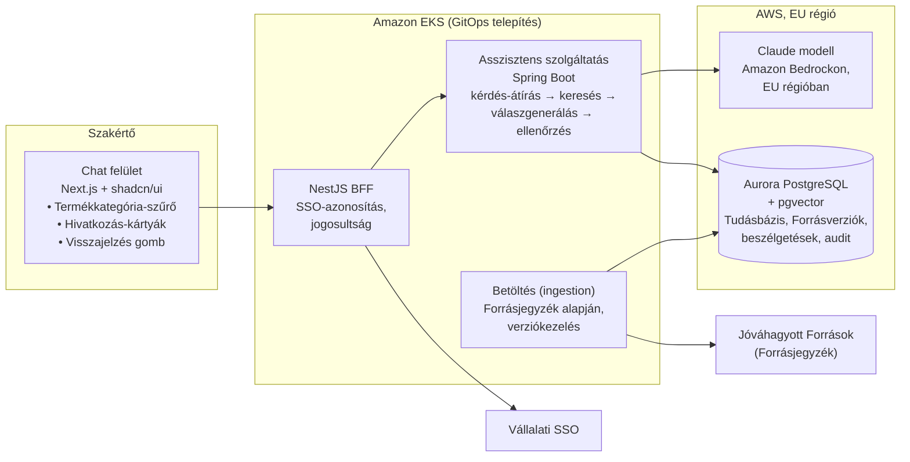
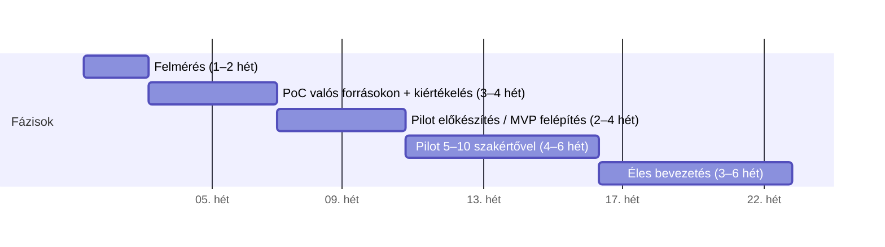

# Szakértői tudásasszisztens – javaslat

*Célközönség: üzleti döntéshozók és szakmai vezetők. Műszaki előismeret nem szükséges.*

## 1. Összefoglaló és javaslat

A szakértők (tanácsadók) ma sok, gyakran változó anyagból keresik ki, mi az aktuális feltétel egy lakáshitelnél, személyi kölcsönnél vagy bankszámlánál. Ez lassú, és egy elavult vagy rossz adat továbbadása az ügyfélnek üzleti és szabályozási kockázat.

**Javaslatunk:** egy belső, csak szakértőknek szóló asszisztens, amely **kizárólag a jóváhagyott Tudásbázisból** válaszol, **minden állítás mellett megmutatja a pontos forrást és annak verzióját**, a választ a kiadás előtt **automatikusan ellenőrzi**, és ha nincs elég bizonyíték, **nem találgat, hanem jelzi, hogy erre nem tud biztos választ adni**.

Azt javasoljuk, hogy fázisokban haladjunk: rövid felmérés, valós forrásokon futó próbaváltozat mérhető minőségi céllal, pilot-előkészítés (chat felület, SSO, Bedrock EU bekötés), utána kis szakértői csoporttal pilot, és csak a mért eredmények alapján éles bevezetés. Az első használható pilot reálisan **6–10 héten belül** indulhat, az éles bevezetés pedig **kb. 3,5–5 hónapon belül** érhető el (a pilot eredményeitől függően), ha a 9. fejezet kérdéseire időben választ kapunk.

A javaslathoz egy működő **proof of concept (PoC)** tartozik, amely a megközelítés lényegét – forrásra hivatkozó, ellenőrzött válaszok verziókezelt tudásbázisból – már most bemutatja (lásd 11. fejezet).

## 2. A kérés, ahogy értjük

Az üzlet olyan mesterséges intelligencián alapuló chatbotot kért, amely:

- **azonnal** válaszol a szakértők kérdéseire;
- **termékkategória szerint szűrhető** (lakáshitel, személyi kölcsön, bankszámla);
- **mindig pontos**;
- **megmutatja, melyik anyagból** származik a válasz;
- és a kérdés: **mikor tudjuk megcsinálni?**

A legnagyobb kihívás nem maga a chatbot, hanem az, hogy a mögötte lévő tudás **naprakész** legyen, és minden válasz **visszakövethető** legyen. Az akciók lejárnak, a díjak és jövedelemhatárok változnak, és ugyanannak a banknak hasonló nevű termékei (például CIB ECO és CIB ECO Plusz) apró, de lényeges részletekben térnek el.

## 3. Mit jelenthet itt az, hogy „mindig pontos”?

Őszintén kell fogalmaznunk: **egyetlen nyelvi modell sem tudja önmagában garantálni, hogy mindig pontos.** Ami viszont garantálható, és amit a megoldás köré építünk:

1. **Csak a Tudásbázisból válaszol.** Az asszisztens nem az internetből és nem a modell „általános tudásából” dolgozik, hanem kizárólag a jóváhagyott Forrásokból. Ami nincs a Tudásbázisban, az számára nem létezik.
2. **Minden állításhoz Hivatkozás tartozik.** A válasz minden bekezdése megjelöli azt a Szövegrészt, amelyre épül, egy konkrét **Forrásverzióban** – vagyis látszik, melyik anyag melyik, mikori állapotából származik az információ. A szakértő egy kattintással ellenőrizheti.
3. **Ellenőrzés a kiadás előtt.** Mielőtt a szakértő bármit látna, egy szabályalapú (nem MI-alapú) ellenőrző megvizsgálja: van-e minden bekezdésnél Hivatkozás, valóban a most megtalált Szövegrészekre hivatkozik-e, és **minden szám, összeg, százalék és időtartam szó szerint szerepel-e a hivatkozott forrásban**. Ha bármi nem stimmel, a válasz nem jut ki.
4. **Elutasítás a találgatás helyett.** Ha nincs elég bizonyíték, vagy az ellenőrzés elbukik, az asszisztens kimondja, hogy erre a Tudásbázis alapján nem tud biztos választ adni – és megmutatja a legközelebbi releváns Forrásokat, hogy a szakértő tovább tudjon lépni. Inkább mondjon nemet tízszer, mint egyszer tévesen igent.
5. **Nincs jóslás, számítás, tanácsadás.** Az asszisztens nem becsül jövőbeli kamatot, nem számol törlesztőrészletet és nem ajánl terméket. Csak azt adja vissza, ami a forrásban le van írva.
6. **A felelősség a szakértőnél marad.** Az asszisztens a keresést és az összefoglalást gyorsítja; az ügyfélnek továbbadott információért továbbra is a szakértő felel. Ezért kap mindig forrást és dátumot a válasz mellé.

Ennek ára is van: a válasz nem „gépelődik” élőben, hanem egészben jelenik meg az ellenőrzés után (néhány másodperc), és a szigorú ellenőrzés időnként akkor is elutasít, amikor a válasz egyébként helyes lett volna. Ezeket mérjük és javítjuk, de nem az ellenőrzés lazításával.

**Amit a szabályalapú ellenőrző önmagában nem tud kiszűrni (két vakfolt):**

- **Jelentésbeli vagy feltételtorzítás:** a szabályalapú ellenőrző a Hivatkozásokat és a számokat ellenőrzi, de nem „érti” a szöveget – így önmagában nem veszi észre, ha a modell kihagy egy lábjegyzetben szereplő feltételt (pl. minimális jóváírást vagy akciós határidőt), vagy felcserél egy tagadást („nem díjmentes” helyett „díjmentes”). *Kezelése:* a lábjegyzeteket és feltételeket a fő szöveggel együtt kereshető Szövegrészként tároljuk, a pontosságot az arany kérdéssoron folyamatosan mérjük, és minden Hivatkozásnál látszik az eredeti idézett szöveg, így a szakértő közvetlenül ellenőrizheti.
- **A Forrás elavulása a következő frissítésig:** ha egy bank napközben módosítja a kondíciókat, a rendszer az újabb betöltésig a korábbi, már elavult Forrásverzióból is szabályosan, „zöld” ellenőrzéssel válaszolhat. *Kezelése:* minden Hivatkozáson szerepel a letöltés dátuma, a Tudásgazda soron kívüli, aznapi frissítést indíthat (lásd 5. fejezet), a szakértők pedig egy kattintással „elavult” jelzést adhatnak.

**Mit jelent az „azonnal”?** Néhány másodperces válaszidőt célzunk; a pontos célértéket a pilot során mért adatok alapján rögzítjük.

## 4. Javasolt megoldás és célarchitektúra

A megoldás a meglévő technológiai környezetbe illeszkedik: Next.js felület, NestJS BFF, Spring Boot szolgáltatások, AWS.

**Az elemek szerepe röviden:**

- **Chat felület (Next.js, shadcn/ui):** a szakértő itt kérdez, több lépésben is (követő kérdésekkel). Termékkategóriára szűrhet, a válasz alatt **Hivatkozás-kártyákon** látja a forrás címét, a bankot, a terméket, az idézett részt és a forrás dátumát. Minden válaszra visszajelzést adhat (hasznos / hibás / elavult).
- **NestJS BFF:** a felület és a háttér közötti réteg; itt történik a vállalati SSO-n keresztüli azonosítás és a jogosultság-ellenőrzés.
- **Asszisztens szolgáltatás (Spring Boot):** a lényegi logika. A követő kérdést önálló kérdéssé alakítja, a Tudásbázisban kulcsszavas és jelentés szerinti kereséssel megkeresi a releváns Szövegrészeket, ezekből választ kér a modelltől, majd ellenőrzi, és csak ezután adja ki. A korábbi válaszokat sosem kezeli tényként: minden kérdésnél újra a forrásokból dolgozik.
- **Aurora PostgreSQL + pgvector:** egyetlen adatbázisban tárolja a Tudásbázist (verziókkal), a beszélgetéseket és a teljes naplót. Ugyanitt fut a kulcsszavas és a jelentés szerinti keresés is – ez fontos, mert a bank- és díjnevek, összegek pontos egyezése ugyanannyit számít, mint a tartalmi hasonlóság.
- **Claude modell Amazon Bedrockon, EU régióban:** a nyelvi modell az AWS-en belül, EU-s régióban fut, így a kérdések nem hagyják el a megszokott felhőkörnyezetet.
- **EKS és GitOps:** a szolgáltatások a meglévő Kubernetes-környezetben futnak, a telepítés verziókezelt, visszakövethető és visszaállítható.

**Miért egyedi megoldás egy dobozos asszisztens helyett?**
Az általános, „dobozos” megoldások (például Amazon Bedrock Knowledge Bases, Microsoft Copilot Studio vagy ChatGPT Enterprise) gyorsan elindíthatók, de pénzügyi tanácsadásnál pontosan a kritikus garanciák hiányoznak belőlük. Nem biztosítanak változtathatatlan **Forrásverziókat** visszamenőleges bizonyítással, nincs bennük kiadás előtti, **szabályalapú szám- és Hivatkozás-ellenőrzés**, nem kényszerítenek ki következetes **Elutasítást** a releváns Források felkínálásával, és nem adnak a megfeleléshez szükséges, lépésről lépésre visszakövethető auditnaplót. Az egyedi szolgáltatás ezeket a szabályokat közvetlenül a saját környezetünkbe építi be, miközben a nyelvi modellt továbbra is menedzselt szolgáltatásként (Bedrock) használjuk.

**Miből áll össze a költség (nagyságrendi arányok)?**
Gyakori tévhit, hogy a nyelvi modell használati díja a fő tétel. Belső szakértői volumen mellett a kérdésenkénti modellköltség (token-díj) tipikusan a teljes költség **kisebb részét** teszi ki. A valódi költségmeghatározó tényező a **kezdeti megvalósítás és integráció** (felület, BFF, SSO, forrásfeldolgozás, minőségmérés), valamint a **folyamatos Tudásgazdai munka** (Forrásjegyzék karbantartása, arany kérdéssor és visszajelzések kezelése). A havi futási költséget a 9. fejezetben kért volumenszámok alapján, a pilot során mért adatokkal pontosítjuk.

## 5. Tudásbázis, Forrásjegyzék és verziókezelés

A megbízhatóság alapja nem a modell, hanem a Tudásbázis minősége.

- **Forrásjegyzék:** egy deklarált lista arról, mely Források tartoznak a Tudásbázisba, és mindegyikhez melyik Termékkategória, bank és banki termék tartozik. Ami nincs a jegyzékben, arról az asszisztens nem beszél. A jegyzékért a **Tudásgazda** felel.
- **Automatikus frissítés:** a rendszer maga tölti le a Forrásokat (kezdetben weboldalakat), és rendszeresen ellenőrzi, változtak-e.
- **Forrásverziók:** ha egy Forrás tartalma megváltozik, új, **változtathatatlan Forrásverzió** jön létre, a korábbi „felülírt” státuszba kerül. A keresés mindig csak az aktuális verziókban dolgozik, de a régi verziók megmaradnak, így **egy hónappal ezelőtti válaszról is pontosan tudjuk, milyen tartalom alapján született**, és látszik, ha azóta a forrás megváltozott.
- **Hibatűrés:** ha egy Forrás letöltése nem sikerül, a meglévő aktuális verzió érintetlen marad; a Tudásbázisból nem tűnik el tudás egy átmeneti hiba miatt. Minden frissítésről jelentés készül (változatlan / új verzió / hiba / kivezetve).
- **Termékkategória:** a Forrásjegyzékből származik, nem a modell találgatja ki, így a szűrés megbízható.
- **Valós banki anyagok (PDF hirdetmények, kondíciós listák):** a banki gyakorlatban a meghatározó feltételek gyakran többhasábos, táblázatos PDF hirdetményekben és kondíciós listákban szerepelnek, hatálybalépési dátumokkal és apróbetűs lábjegyzetekkel. Ezeket nem elég egyszerű szövegként kiolvasni: a 2. fázisban (valós forrásos PoC) strukturált táblázat- és lábjegyzet-feldolgozást vezetünk be, hogy a díjak, sávok, hatályossági dátumok és feltételek összetartozó Szövegrészek maradjanak.
- **Napi működés és aznapi sürgős frissítés:** az ütemezett frissítés mellett a Tudásgazda **kézi, azonnali, egyedi Forrás-újratöltést** is indíthat, ha egy bank napközben módosítja a kondíciókat – így a sürgős változások még aznap megjelennek a Tudásbázisban. Emellett a Tudásgazda heti rendszerességgel áttekinti a szakértők által „hibás” vagy „elavult” jelzéssel megjelölt válaszokat, és ennek alapján frissíti vagy pontosítja az érintett Forrásokat.

## 6. Minőségmérés

A „mindig pontos” csak akkor több ígéretnél, ha mérjük. Ezeket javasoljuk:

- **Arany kérdéssor:** a szakértőkkel közösen összeállított, kb. 100–200 valós kérdés a várt válasszal és forrással, kategóriánként. Minden változtatás (új modell, új forrás, új prompt) után lefuttatjuk.
- **Hivatkozási pontosság:** a válaszok hány százalékában támasztja alá valóban a hivatkozott Szövegrész az állítást. Ez a legfontosabb mutató; célértéke 100%-hoz közeli.
- **Elutasítási arány:** milyen gyakran mondja az asszisztens, hogy nem tud válaszolni – külön nézve a jogos elutasításokat (nincs rá forrás) és a feleslegeseket (lett volna forrás). A túl magas arány használhatatlanná teszi az eszközt, ezért ezt is célértékhez kötjük.
- **Szakértői visszajelzés:** minden válasz értékelhető (hasznos / hibás / elavult, megjegyzéssel). A „hibás” és „elavult” jelzéseket a Tudásgazda heti rendszerességgel átnézi.
- **Teljes napló:** minden válaszhoz visszakereshető, milyen Szövegrészeket talált a rendszer, mit kapott a modell, mit válaszolt, és mit mondott az ellenőrző. Ez hibakereséshez és audithoz is kell.

## 7. Biztonság és megfelelőség

- **Azonosítás:** csak vállalati SSO-val belépett szakértők használhatják; minden beszélgetés a szakértőhöz kötött, mások nem látják.
- **Adatrezidencia:** az adatbázis és a nyelvi modell is AWS EU régióban fut.
- **Audit:** minden kérdés, válasz, hivatkozás és ellenőrzési eredmény naplózva van, a megőrzési időt az üzlettel közösen határozzuk meg.
- **Nincs ügyféladat a kérdésekben:** az asszisztens termékfeltételekről szól, nem konkrét ügyfelekről. A szakértők útmutatást kapnak, hogy ne írjanak be nevet, azonosítót, jövedelmi adatot; ezt a felületen is jelezzük. Automatikus személyesadat-szűrés későbbi lépés lehet.
- **GDPR, adatvédelmi hatásvizsgálat (DPIA):** az éles bevezetés előtt az adatvédelmi tisztviselővel közösen elvégezzük; a pilot ennek előfeltétele.
- **Manipulációs kitettség korlátozása:** a modell csak a Forrásjegyzékben szereplő, jóváhagyott Forrásokból kap szöveget, így egy rosszindulatú tartalom („prompt injection”) csak ezeken keresztül juthatna be. A szabályalapú ellenőrzés ezen felül megakadályozza, hogy forrás nélküli szám vagy állítás kijusson.

## 8. Kockázatok és kezelésük

| Kockázat | Hatás | Kezelés |
|---|---|---|
| A források elavultak vagy hiányosak | Elavult, de „hivatkozott” válasz | Tudásgazda kijelölése, automatikus frissítés, dátum minden Hivatkozáson, „elavult” visszajelzés |
| Túl sok elutasítás | A szakértők nem használják | Elutasítási arány mérése, forrásbővítés, keresés hangolása a pilot alatt |
| Hasonló termékek összekeverése (pl. CIB ECO vs. ECO Plusz) | Rossz termékfeltétel az ügyfélnél | Termékenkénti külön válasz, banki termék a Hivatkozás-kártyán, célzott tesztkérdések |
| Főleg kalkulátorokból álló oldalak, kevés szöveg | Kevés bizonyíték egyes kategóriákban | Belső termékleírások bevonása forrásként; addig a jogos elutasítás a helyes viselkedés |
| A szakértő ellenőrzés nélkül továbbadja a választ | Felelősségi kérdés | Forrás és dátum mindig látható, képzés, egyértelmű felelősségi szabály |
| Modell- vagy szolgáltatóváltozás | Minőségromlás | Arany kérdéssor minden váltás előtt, modellverzió rögzítése a naplóban |
| Válaszidő | „Nem azonnali” érzet | Állapotjelzés („keresés…”, „ellenőrzés…”), mért célérték a pilotban |
| Adatvédelmi megfelelés | Bevezetés csúszik | DPIA korai indítása, EU régió, ügyféladat-mentes kérdések |

## 9. Nyitott kérdések az üzlet felé

Ezek megválaszolása nélkül a becslés csak sáv lehet:

1. **Források és formátumok:** pontosan mely anyagok kerüljenek a Tudásbázisba? Csak nyilvános weboldalak, vagy belső PDF-ek, Word-dokumentumok, Confluence/SharePoint oldalak, bankoktól kapott kondíciós listák is?
2. **Gazdák és frissítési gyakoriság:** ki a Tudásgazda kategóriánként? Milyen gyakran változnak az anyagok, és mennyi késés elfogadható egy változás és annak megjelenése között?
3. **Tartalom jóváhagyása:** ki hagyja jóvá, hogy egy új Forrás vagy egy forrásváltozás bekerülhet? Kell-e emberi jóváhagyás minden új verzióra?
4. **Nyelvek:** elég-e a magyar, vagy kell angol (vagy más) nyelvű kérdés-válasz is?
5. **Volumen:** hány szakértő, napi hány kérdés, milyen csúcsidőszakok? Ez a költséget és a méretezést határozza meg.
6. **Megőrzés:** mennyi ideig kell megőrizni a beszélgetéseket és a naplót (belső és szabályozói elvárás)?
7. **Elfogadási küszöb:** milyen hivatkozási pontosság és elutasítási arány mellett tekintjük a pilotot sikeresnek?

## 10. Ütemterv

A „mikor tudjátok megcsinálni?” kérdésre a becsületes válasz sávokban adható meg, mert a legnagyobb bizonytalanság a források köre és minősége (9. fejezet).

*A dátumok a sorrendet és a felső becslési sávot szemléltetik; a tényleges kezdés a döntéstől függ.*

| Fázis | Időtartam | Előfeltétel | Eredmény |
|---|---|---|---|
| **1. Felmérés** | 1–2 hét | Kijelölt üzleti kapcsolattartó és Tudásgazdák; elérhető minta anyagok | Megválaszolt nyitott kérdések, forráslista, első 100–200 kérdéses arany kérdéssor, sikerkritériumok |
| **2. PoC valós forrásokon, kiértékeléssel** | 3–4 hét | Hozzáférés a valós forrásokhoz; AWS-fiók és teszt Bedrock EU-hozzáférés; arany kérdéssor | Valós forrásokon (szükség esetén strukturált PDF-feldolgozással) futó asszisztens, mért hivatkozási pontosság és elutasítási arány, döntési javaslat a pilotról |
| **3. Pilot előkészítés / MVP felépítés** | 2–4 hét | Sikeres PoC-kiértékelés és döntés a pilotról; SSO-beállítások; EKS-környezet | Next.js chat felület, NestJS BFF, vállalati SSO-integráció, éles Amazon Bedrock EU bekötés, pilotra kész környezet |
| **4. Pilot 5–10 szakértővel** | 4–6 hét | Elkészült pilot-környezet (chat felület, BFF, SSO, Bedrock EU); DPIA folyamatban; szakértői képzés | Valós használati adatok, szakértői visszajelzések, finomhangolt források és küszöbök, méretezési és költségadatok |
| **5. Éles bevezetés** | 3–6 hét (a pilot eredményeitől függ) | Elért elfogadási küszöbök; lezárt DPIA; üzemeltetési és ügyeleti rend; Tudásgazdai folyamat működik | Fokozatos kiterjesztés minden szakértőre, folyamatos minőségmérés |

Összességében: **a pilot 6–10 hét múlva indulhat**, az éles bevezetés pedig jellemzően **kb. 3,5–5 hónapon belül** reális, ha az előfeltételek időben teljesülnek. A legnagyobb csúszási kockázat a források elérhetősége és az adatvédelmi jóváhagyás.

## 11. Mit mutat meg a mellékelt proof of concept – és mit nem

**Amit bemutat:**

- A Tudásbázist **nyilvános Bankmonitor-oldalakból** építi fel (bankszámla, lakáshitel és személyi kölcsön kategóriában), amelyeket **futás közben maga tölt le** a Forrásjegyzék alapján; a tartalmat nem tároljuk a kódban.
- Verziókezelést: változáskor új Forrásverzió jön létre, a régi felülírt lesz, a korábbi Hivatkozások megtartják az eredeti verziót.
- Termékkategória-szűrést, többlépéses beszélgetést követő kérdésekkel.
- Kulcsszavas és jelentés szerinti (hibrid) keresést, ékezetfüggetlenül.
- Hivatkozásokat minden bekezdéshez, a szabályalapú ellenőrzést, és az elutasítást, ha nincs bizonyíték vagy az ellenőrzés elbukik.
- Hasonló termékek (CIB ECO és CIB ECO Plusz) elkülönítését a Hivatkozásokban.
- Szakértői visszajelzést és teljes naplót minden válaszhoz.
- Interaktív kipróbáláshoz egy beépített, egyszerű magyar nyelvű **API-tesztkonzolt** (a Swagger UI mellett), amelyen a háttérszolgáltatás böngészőből közvetlenül tesztelhető.
- A működést automatikus tesztek igazolják.

**Offline mód:** a PoC kulcs nélkül is futtatható egy determinisztikus, „offline” üzemmódban, amely nyelvi modell helyett a legjobban illeszkedő mondatokat emeli ki a forrásból. **Ez kizárólag azért létezik, hogy a PoC API-kulcs nélkül is kipróbálható legyen**; nem a javasolt éles működés. Valódi nyelvi modellel (Anthropic Claude vagy helyi, OpenAI-kompatibilis modell) is futtatható.

**Amit nem mutat be (szándékosan, a következő fázisokra hagyva):**

- éles Next.js szakértői chat felület és NestJS BFF (ezek a 3. fázisban készülnek el; a PoC-hoz mellékelt magyar nyelvű API-tesztkonzol és a Swagger UI csak a háttérszolgáltatás kipróbálására szolgál);
- valódi SSO – a PoC-ban egy fejléc helyettesíti a szakértő azonosítását;
- Amazon Bedrock bekötése (a meglévő modellcsatlakozók ugyanezt a mintát követik);
- weboldalakon kívüli forrásformátumok (PDF, Word, Confluence, SharePoint);
- automatikus kiértékelő keretrendszer és arany kérdéssor;
- adatelérés: jOOQ kódgenerálás a Flyway sémából; a JPA-t tudatosan nem választottuk (ld. ADR-0006);
- személyesadat-szűrés, terheléskorlátozás, éles üzemeltetés.

A PoC tehát azt bizonyítja, hogy a **megközelítés** működik: forrásra hivatkozó, ellenőrzött, verziókövetett válaszok. Azt, hogy a **valós belső forrásokon** milyen minőséget ér el, a 2. fázis méri meg.

## Függelék: fogalmak

A dokumentum a projekt fogalomtárát (`GLOSSARY.md`) követi:

| Magyar | Fogalomtár (angol) | Jelentés |
|---|---|---|
| Szakértő | Expert | Belső tanácsadó, aki kérdez, és továbbadja az információt az ügyfélnek; felelős érte |
| Tudásgazda | Knowledge Owner | Felel azért, mely Források vannak a Tudásbázisban, és hogy ezek helyesek, naprakészek |
| Tudásbázis | Knowledge Base | A jóváhagyott Források összessége; ezen kívül semmi nem számít tudásnak |
| Forrás | Source | Egy tudásanyag állandó azonosítóval (pl. egy termékoldal) |
| Forrásverzió | Source Version | Egy Forrás tartalmának változtathatatlan pillanatképe; mindig egy aktuális van |
| Szövegrész | Passage | Egy Forrásverzió összefüggő része, amelyet keresünk és hivatkozunk |
| Forrásjegyzék | Source Registry | A Források deklarált listája kategóriával, bankkal, banki termékkel |
| Termékkategória | Product Category | Lakáshitel, személyi kölcsön vagy bankszámla |
| Banki termék | Bank Product | Egy bank konkrét terméke (pl. CIB ECO Plusz bankszámla) |
| Beszélgetés | Conversation | Egy szakértő kérdés-válasz sorozata egy témában |
| Válasz | Answer | Csak Hivatkozással alátámasztott állításokból álló válasz |
| Hivatkozás | Citation | Utalás egy állításról a pontos Forrásverzió-szövegrészre |
| Elutasítás | Refusal | Válasz, amely kimondja, hogy nincs elég bizonyíték, ahelyett hogy találgatna |
